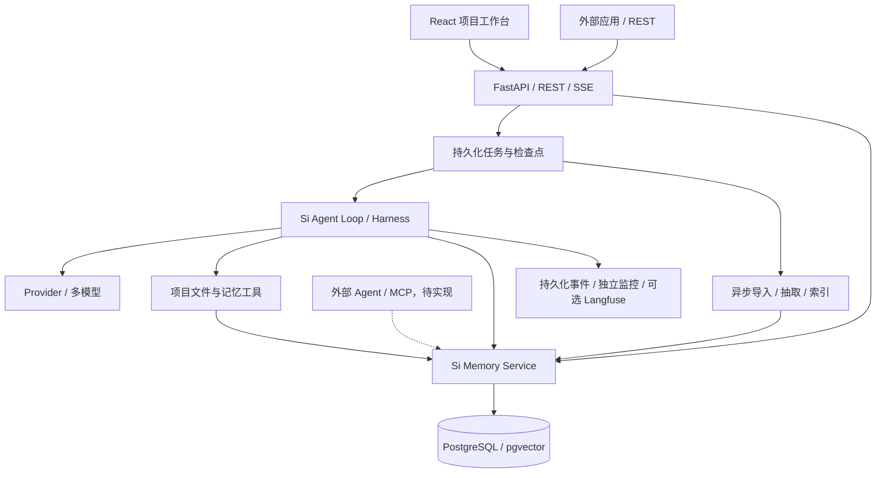

# Si-agent

Si-agent 是面向项目开发与知识工作的 AI Agent，支持项目文件工具、多模型、流式对话，以及可追溯、可纠错的长期记忆。

系统以自主 Agent Loop 和 Harness 执行任务，以 Si Memory 保存资料、事实、决策和流程。记忆服务通过独立契约接入运行时，也可以通过 REST 被其他应用调用；面向外部 Agent 的 MCP 接入正在规划。

## 当前能力

- **项目对话**：项目下管理多个会话，支持 Markdown、引用、真实流式输出、工具进度、人工审批与取消。
- **项目文件**：关联受允许范围约束的本地文件夹，或上传文件夹快照；提供只读文件列表、分段读取和文本搜索。
- **长期记忆**：用 `si://` 组织资料、事实、事件和流程，支持 L0 摘要、L1 概览、L2 原文与证据引用。
- **混合检索**：PostgreSQL 全文检索与 pgvector 融合，检查项目范围、有效性、来源版本和遗忘屏障。
- **记忆生命周期**：异步导入、候选抽取、确认、修正、版本、冲突与忘记；原始记录和表示层更新分离。
- **Agent Harness**：模型与工具预算、持久化上下文摘要、调用预算结算、工具原文回读、工具入参校验、操作幂等、审批、outbox、检查点及持久化事件流。
- **多模型**：OpenAI、Anthropic 和 OpenAI-compatible；密钥仅保留在后端。
- **项目监控**：独立运行/任务界面、模型用量及检索/模型/工具时间线；可选 Langfuse OTLP 导出。

当前版本面向单用户、多项目、本地部署。文件工具只读；不提供 shell、自动代码修改、复杂登录或公网多租户部署。

## 快速启动

需要 Git、Docker 和 Docker Compose：

```bash
git clone git@github.com:tangjujia9-jpg/Si-agent.git
cd Si-agent
docker compose -f infra/compose.yaml up -d --build
```

- 工作台：<http://127.0.0.1:8080>
- 项目监控：<http://127.0.0.1:8080/monitor>
- API 文档：<http://127.0.0.1:8000/docs>

默认启动使用离线演示模型和演示向量，用于复现完整产品流程，不能代表真实推理或语义检索质量。
真实模型需要显式配置：

```bash
cp infra/copilot.env.example infra/copilot.env
# 在本机填写模型地址、模型名和密钥，再启动：
docker compose --env-file infra/copilot.env -f infra/compose.yaml up -d --build
```

Embedding、摘要和抽取的可选配置见[记忆手册](docs/copilot-memory.md)和[真实模型示例](infra/real-models.env.example)。
`infra/copilot.env` 被 Git 忽略，不要提交填有凭据的配置。

数据库使用持久卷。`docker compose -f infra/compose.yaml down` 会停止服务并保留卷；请勿通过删除卷排查启动问题。
容器默认无法访问宿主机项目目录，可先上传文件夹快照；本地关联需要显式只读挂载。

Windows 原生开发、WSL PostgreSQL 和本机模型隧道的步骤见[运行手册](docs/copilot-backend.md)。

## 十分钟体验

1. 添加项目，关联目录或上传 Markdown、文本与代码文件夹快照。
2. 预览并勾选资料，等待后台索引完成。
3. 新建会话，询问项目架构、约束或历史决策，查看流式回答和引用。
4. 让 Agent 读取项目文件，在对话中展开工具执行过程。
5. 打开“项目记忆”，确认一条建议，再修正其中的事实并检查来源版本。
6. 在另一个会话追问，确认使用更新后的事实。
7. 打开“项目监控”，查看查询 Embedding、召回、模型和工具的实际耗时。

首次真实索引需要 Embedding 额度；UTF-8 文本和代码已支持，PDF/Word 解析尚未接入。

## 架构



Si-agent 自己持有 Memory、Provider、Tool Contract、上下文组装和评测契约。
默认运行时不依赖 LangChain、LangGraph；LangGraph 仅作为可选工作流适配层。

| 目录 | 职责 |
|---|---|
| `apps/web/` | React、Vite、TypeScript 中文工作台 |
| `waku/domain/` | 无第三方依赖的领域数据契约 |
| `waku/runtime/` | Agent Loop、预算、决策、恢复与观测 |
| `waku/memory/` | namespace、证据、版本、留存与检索服务 |
| `waku/providers/` | 模型协议、能力目录和 Provider 适配器 |
| `waku/tools/` | 工具 schema、执行器及范围受限的工具 |
| `waku/server/` | API、SSE、项目与会话管理 |
| `waku/storage/`、`infra/` | 数据映射、迁移与部署 |
| `waku/workers/` | 导入、抽取、索引和 outbox 后台任务 |
| `evals/` | 程序边界、检索基线与 judge 评测 |

Python 包目录暂留兼容名称，产品名称与长期记忆 URI 使用 Si-agent / `si://`。

## 记忆作为独立能力

Si Memory 的检索和写入不要求运行 Agent 对话。现有 REST 提供检索、原文、证据、版本、候选确认、修正和忘记接口。
外部应用可以在可信本机环境调用 API；现有单用户 API 尚不具备公网鉴权。

完成开发工具闭环后，以 MCP stdio 适配器连接外部 Agent：服务配置固定身份、项目和权限，读取返回相同的引用与证据，写入复用候选、审批、版本与遗忘规则。
这项能力尚未验收，不能把旧版外部记忆客户端视为已经实现的 Si Memory 服务端。
详见[上下文与独立记忆服务设计](docs/copilot-context-budget-design.md)。

## 开发与验证

```bash
uv sync --frozen --extra dev --extra copilot
uv run --no-sync ruff check waku evals scripts hosted
uv run --no-sync pytest -q evals/deterministic
cd apps/web
npm ci
npm test
npm run build
```

完整回归在 Linux CI 执行；真实 PostgreSQL 用例需要配置 `SI_TEST_DATABASE_URL`。
Compose CI 同时执行 API 与浏览器验收。真实模型和 LLM judge 需要显式配置，不在离线 CI 中运行。

已完成真实 hy3 文本/工具/流式调用和 Qwen 1024 维向量的小样本验证。
这些记录不代表所有模型能力、稳定任务成功率或生产吞吐量。PostgreSQL 质量基线、Eval Lab 和真实 Langfuse 服务联调仍待完成。

## 文档

| 文档 | 内容 |
|---|---|
| [运行手册](docs/copilot-backend.md) | 本机与 Docker 启动、数据库迁移、配置 |
| [工作台手册](docs/copilot-console.zh-CN.md) | 对话、文件夹、记忆和监控操作 |
| [记忆设计](docs/copilot-memory.md) | 分层表示、混合检索、证据 |
| [统一记忆方案](docs/si-unified-memory-design.md) | 检索门、增量蒸馏、冲突与遗忘 |
| [运行时设计](docs/copilot-runtime.md) | Loop、工具审批、Provider 与恢复 |
| [工作台验收](docs/copilot-workspace-release.md) | PostgreSQL 迁移、真实模型与 CI 证据 |
| [长任务上下文验收](docs/copilot-context-continuity-release.md) | 分层上下文、语义摘要、预算结算、原文回读 |
| [后续计划](docs/copilot-roadmap.md) | 独立记忆服务、基线、Eval Lab、Langfuse |
| [全部文档](docs/README.md) | 开发记录与参考材料 |

## 许可证与来源

本项目包含源自 [ShenSeanChen/waku-agent](https://github.com/ShenSeanChen/waku-agent) 的 MIT 代码，原版权声明保留在 [LICENSE](LICENSE)。

`hosted/` 使用独立的 [ELv2 许可证](hosted/LICENSE)，不属于 Si-agent 产品部署；上游品牌及部分图示另有授权，见 [LICENSE-BRAND](LICENSE-BRAND)。
本 README 使用独立文字与架构图，不使用上游宣传素材。外部记忆系统的可选集成需要分别核对版本和许可证。
