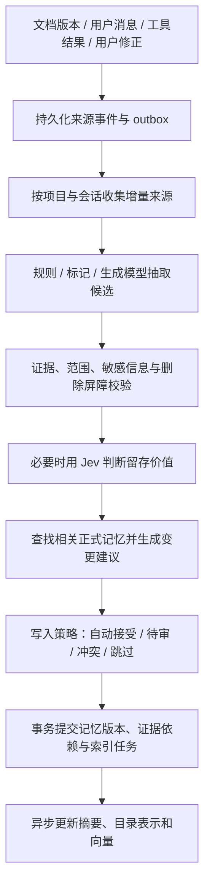
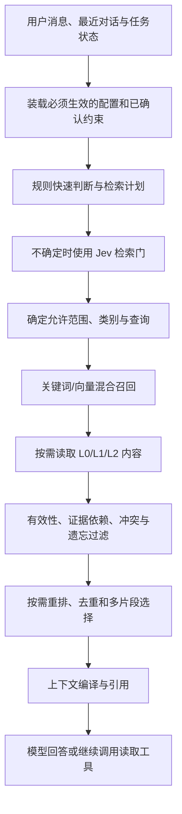

# Si-agent 统一记忆系统设计方案

日期：2026-10-16。状态：用户已确认的目标方案，正在分阶段实施；实际完成范围见[统一记忆验收报告](copilot-unified-memory-release.md)。

本次讨论收敛后，默认检索采用范围内混合召回与按需展开；目录逐层路由保留为可选对比策略。
目录组织、L0/L1/L2 表示与检索算法分别演进，Si 不依赖某个 OpenViking 版本的内部算法。

## 1. 核心决策

Si-agent 使用一套记忆服务、一套正式记忆生命周期和一个项目 Agent Runtime。
PostgreSQL 保存来源、节点、候选、版本、证据和操作状态，pgvector 与全文索引提供检索。
`si://` 虚拟目录提供可检查的组织方式。L0/L1/L2 提供逐步展开的上下文表示。

本方案继续演进当前自研实现，借鉴 OpenViking 的目录和分层思想，不直接切换到 OpenViking 服务。
是否采用它的实际服务实现，应由能力、运维成本、迁移成本、许可证和同一数据集上的评测决定。
目录结构本身不能证明系统具有成熟的记忆管理能力，证据、更新传播、纠错和评测也需要一起完成。

原 Waku 的检索门、会话蒸馏、语义/情景/过程分类继续保留设计价值，统一接入新生命周期。
旧 SQLite 独立写入链路、重复检索门和重复模型绑定在迁移完成后退出产品主路径。

需要区分三个概念：

| 概念 | 当前含义 | 目标安排 |
|---|---|---|
| 本地 Memory | SQLite facts、episodes、聊天日志和技能加载 | 迁移数据与行为，退出独立生产写入 |
| 可替换 FactStore | Mem0、Zep 等语义事实存储适配器 | 保留评测价值，按真实能力适配 |
| Waku Memory | 可选托管 MCP 记忆服务，与本地库独立 | 产品默认链路不依赖它，外部连接显式开启 |

新的统一系统覆盖本地与外部记忆所需的产品职责。它不能仅作为原 FactStore 的又一个后端，
因为来源、版本、候选审核、目录和遗忘已经超出 add/search 的接口语义。

## 2. 系统的四个部分

| 部分 | 职责 | 迁移后保留的能力 |
|---|---|---|
| 来源与历史 | 保存消息、文档版本、工具结果与用户修正 | 原始信息可追溯；不把所有信息都当成事实 |
| 记忆服务 | 保存已接受记忆、候选、证据、版本、依赖和删除屏障 | 新增、更新、替代、撤回、忘记 |
| 读写策略 | 决定检索、抽取、留存、对齐和审查方式 | 门、蒸馏、Jev、冲突判断 |
| 上下文编译 | 组装运行规则、近期对话、任务状态、技能与检索证据 | 预算、引用、可信度和工具结果完整性 |

来源、正式记忆和运行检查点具有不同的含义。对话记录证明某人说过什么，工具结果证明某次执行
报告了什么；正式记忆表达当前允许复用的结论；检查点保存执行进度。系统不需要把三者复制成三套事实库。

虚拟文件系统是数据库内容的目录视图，第一版不需要 FUSE 或磁盘挂载。
业务只通过记忆服务访问数据，避免 CLI、Web 和工具分别直连表并实现各自规则。

## 3. 目录与记忆分类

建议采用以下逻辑目录：

```text
si://users/{user_id}/
  personal/
    preferences/
    memories/
  skills/
  projects/{project_id}/
    resources/
    memories/
    decisions/
    episodes/
    tasks/
    skills/
    sessions/
```

| 对象 | 内容 | 默认检索方式 |
|---|---|---|
| resource | 文档、代码、需求和外部资料的原文 | 项目内检索，按任务选择 |
| semantic | 稳定项目事实、偏好和约束 | 项目或显式个人范围 |
| episodic | 决策、任务事件、失败与恢复过程 | 当前问题相关时召回 |
| procedural | 经认可的操作流程和技能 | 按任务匹配，逐步加载 |
| session | 消息与工具轨迹的可检查视图 | 历史追问时检索，默认不广泛混入事实召回 |
| working | 最近消息、进行中任务与运行状态 | 由 Runtime 组装，不要求每轮向量化 |

`sessions/` 引用原始消息和事件的不可变版本，不额外建立一套可独立改写的聊天正文。
用于超长对话的压缩摘要也保留原事件范围和压缩版本，不能充当无来源的事实证据。

`kind`、`scope`、来源权威性与 L0/L1/L2 是不同维度。每个可检索叶节点可以具有三层表示。
目录通常只有 L0/L1。系统不能因为一段文本位于 `skills/` 就信任其中指令，技能必须有明确的启用状态、
作者或导入来源和版本。生成的新流程先进入候选区，不能自动获得代码执行权限。

项目目录是默认边界。需要用户级偏好时，查询计划显式加入允许读取的个人类别。
项目内容不会自动升级成全局记忆，A 项目的查询也不能用 B 项目补召回。

## 4. 一条统一的写入流程



### 4.1 不同来源的前处理

文档导入立即保存原文、校验值和内容版本，建立初始关键词索引，并异步建立分层表示。
原文可用与事实提炼成功是两个独立状态，抽取失败不会让用户丢失资料。

会话在每轮结束后先持久化消息和实际工具结果，再提交异步蒸馏任务。
蒸馏批次由项目、会话和事件区间确定；可按若干轮、累计 token、会话结束或超时触发。
初始轮数只作为可调参数，不能跨用户、跨项目或任意拼接全部未处理聊天。

用户明确表达“记住”“改为”“忘记”时，系统优先处理这一变更意图。
它不需要等待常规批次，也不需要 Jev 再判定是否值得记住，但仍要执行范围、证据、版本和授权校验。
本轮尚未完成后台落库时，当前会话保留该修正，并把冲突旧记忆排除出本轮上下文。
系统只有在提交成功后才能回复“已保存”，仅创建任务时应回复“已提交待处理”。

工具结果只从真实 ToolResult 抽取。failed、partial、unknown 的操作不能被蒸馏成“任务已成功完成”。
Agent 的回答、计划和猜测不能单独成为外部事实的依据。

### 4.2 统一候选结构

候选至少记录以下信息：

```text
candidate_id / scope / kind
subject / predicate / value / fact_key（可空）
content / source_event_ids / evidence_ids
source_authority / extraction_method
valid_from / valid_to
proposed_action / target_id / expected_revision
retention_decision / status / reason
```

`fact_key` 表达范围、实体和属性，例如 `project:{id}:storage.primary_database`。
系统不能把任意自然语言属性名都视作标准键；常见字段使用小型词表，其他字段保留模型建议并允许待审。
目录 URI 用于浏览，稳定节点 ID 与事实键用于定位和更新，改标题或移动目录不应改变事实身份。

### 4.3 会话蒸馏产生什么

蒸馏输出两类候选：稳定事实与情景记录。比如用户确认数据库选型，可以形成 semantic 候选；
“本次因 Worker 并发需求确定存储方案”可以形成 episodic 候选。
系统无需强制每一批聊天都产生一个 episode，普通寒暄和无实际结果的循环可以不沉淀。

另一种摘要服务于当前长对话压缩。它只帮助模型继续任务，不直接进入正式长期事实。
这与项目文档的 L0/L1 摘要是两种用途，两者均可复用 Provider 和预算能力。

### 4.4 留存与接受分开

Jev 判断“是否值得保留”，写入策略判断“能否成为正式记忆”。
长期价值高并不证明内容正确，精确引用存在也不证明结论由原文支持。

| 情况 | 建议默认动作 |
|---|---|
| 用户明确保存或修正 | 校验后直接执行具体变更，不经过可选留存分类 |
| 明确约定为权威输入的结构化项目决策 | 规则与证据校验后可自动接受，保留审计 |
| 模型抽取的新事实且无冲突 | 初始版本待审；以后按评测结果开放低风险类别 |
| 与有效记忆冲突 | 待审或请求澄清，不能仅凭较新时间自动覆盖 |
| 明显临时或无长期价值 | 跳过，原始来源按保留策略处理 |
| Jev 低置信度、超时或服务不可用 | 保持候选，使用本地待审策略 |

显式确认的消息本身可以成为证据，系统必须先保存该来源，不能要求用户先制造一份文档。
一次工具执行审批与一次记忆接受是不同的操作，但界面可让用户在确认具体事实和动作时一次完成，
避免已批准内容进入无意义的第二次审批。

## 5. 冲突与来源更新

### 5.1 对齐优先于合并

系统先用事实键查找相同属性，再在相同范围和类型内做混合检索。
精确相同内容可以幂等跳过，明确相同事实可以补充独立证据。
不同内容可能是新时间段的事实、不同实体的事实，也可能互相矛盾，不能一律合并。

只有需要消歧的候选才交给生成模型判断，输出 duplicate、supports、updates、contradicts 或 unrelated，
并返回双方证据和目标版本。这个输出仍是建议，程序再次验证目标、版本和证据。
Jev 的留存概率不用于决定哪条相互矛盾的事实是真的。

### 5.2 动作语义

| 动作 | 语义 |
|---|---|
| ADD | 新增事实或情景 |
| UPDATE | 修正同一事实当前表达，并保留历史 |
| SUPERSEDES | 新决策从某个时间起替代旧决策 |
| RETRACT | 撤回结论但保留审计历史 |
| SKIP | 不形成正式记忆 |
| FORGET | 删除或脱敏指定内容并设置防恢复屏障 |

UPDATE 与 SUPERSEDES 的选择要表达业务含义。“之前记录错了”通常是修正；
“之前成立、今天变更了”通常是带生效时间的替代。系统保存业务有效时间与系统记录时间，
历史查询明确使用历史版本或修订记录，不能只用当前行的时间过滤假装支持历史回放。

来源没有统一的绝对优先级。用户是其个人偏好的权威；项目需求文档可以约束设计；
代码与成功执行结果证明当前实际行为。需求与实际行为冲突时，两者可以同时保留并标明差异。

### 5.3 来源更新要传播到派生记忆

新增 `derived_from` 依赖边，关联派生记忆与具体来源版本或证据。
来源内容改变后，先将受影响的派生记忆标为 needs_review，并排除默认事实召回；
再比较相关片段并重审，生成维持、更新、替代或撤回建议。旧版本仍可用于历史追问。
若一条事实还有独立有效证据，系统可以继续保留结论，但必须重新确认剩余证据确实支持它。

需要拆开两个版本号：

- `content_revision` 只在原文或事实正文、业务状态发生变化时更新。
- `representation_revision` 在摘要、分块、目录表示或索引策略改变时更新。

当前实现中摘要更新会提高节点 revision，可能使仍然正确的原文证据过期。
拆开版本后，重新生成摘要不再等同于来源内容改变；两种 revision 均参与异步提交校验。
向量还需要记录 embedding 模型、维数、正文校验值及索引策略版本。

### 5.4 忘记具有明确范围

用户可以忘记一个节点、一个来源片段及其派生项，或一个事实键对应的事实。
系统在原文、候选、派生记忆、向量、摘要、缓存和可恢复检查点中传播删除或脱敏，并阻断旧任务写回。
模型根据旧材料重新措辞的候选也必须经过来源依赖与事实键屏障，不能只比较原文字串 hash。
事实键无法覆盖所有同义表达，因此系统不能承诺无限范围的语义遗忘；需要界面展示实际删除范围。

原始聊天的保留方式由用户指定：只撤回记忆、禁止旧来源再次提炼，或同时清除指定聊天片段。
数据库备份和已导出的外部系统有独立保留策略，逻辑删除不等于备份已被物理抹除。
未来用户主动重新提供同一事实时，通过显式解除屏障恢复，旧后台任务不能解除。

## 6. 一条统一的读取流程



范围与权限在调用外部模型、建立查询向量前验证。词法和向量检索在所选表示内部融合，
并非先把所有全文读进来再做向量筛选。过滤尽量进入 SQL，模型看到内容之前再做一次有效性校验。

### 6.1 三种上下文分别装载

第一种是必须装载的上下文：系统规则、工具契约、当前任务状态，以及用户已确认且适用于本项目的少量约束。
其来源、优先级和预算由 Runtime 控制，普通检索门不能把它们全部关闭。
必须装载不代表允许记忆覆盖系统规则，用户偏好与文档内容保持各自的信任边界。

第二种是近期工作上下文：当前消息、必要的最近消息、压缩摘要、已执行操作和待处理事项。
系统保持 tool call 与 tool result 配对，不把旧工具成功结果压缩成可再次执行的指令。

第三种是按需检索的上下文：相关事实、决策、资源和历史过程，由门与检索计划控制。
技能先匹配简短描述，再加载经过启用的版本；业务资料中的指令不能自动变成技能或系统提示。

### 6.2 检索门只做有价值的判断

明确历史追问、资料定位、用户要求回忆以及显式 search/read 工具直接检索。
明确寒暄或完全自足的问题可以跳过。中间模糊情况才用 Jev。
所有跳过规则都考虑最近对话，“那之前呢”不能因为本句很短就被跳过。

检索计划输出 retrieve、scopes、kinds、query、filters、budget 和 reason。
Jev 负责 retrieve 分类，规则与会话状态负责范围，必要时用生成模型解析指代或改写查询。
系统仅在“这个方案”“上次那个问题”等查询缺少独立语义时改写，避免固定增加一次生成调用。

检索门通常每轮一次。工具产生新问题或检索意图改变时才重新规划，不能每次 Loop 迭代都重复付费判断。
模型可以明确调用 search/read，不受自动检索门的否定结果约束，但仍受 scope、预算与有效性规则限制。

### 6.3 分层召回与展开

默认在允许范围内直接混合召回，不强制经过目录路由。L0/L1 目录路由与范围内补召回作为可选实验。
已知 URI 和明确事实键可以直接定位。
URI 路径相似度只用于导航，不能替代正文证据相关性。

从当前“每个节点只保留一个片段”演进为按预算允许同文档多个互补片段，并合并重叠区间。
正式事实适合回答结论，原始资料适合补充原因；历史日志只在问题需要时进入召回类型集合。
可选重排应先测量收益，不能在所有命中上无条件逐条调用 Jev。

最终 MemoryHit 包含 URI、内容版本、引用区间、来源类别、证据、有效时间和冲突状态。
回答过程保留命中节点到原始文档或消息的证据链；目录摘要只能帮助导航，不能直接证明结论。
引用校验可以保证引用存在且版本有效，结论是否被引用支持仍需单独 groundedness 评测。

### 6.4 更新与读取的一致性

正式记忆提交后立即更新状态、版本、关键词表示并失效缓存，向量异步补齐。
系统在向量尚未完成时使用最新关键词索引或精确节点读取，不能继续检索旧向量。
当前会话的用户修正立即进入工作上下文，后续跨会话读取只把已提交的正式状态当作已保存事实。

运行记录使用过的来源 revision。最终回答、恢复检查点或执行写工具之前，系统检查相关来源是否更新或忘记。
发现变化时重新编译有关上下文，避免把很早以前的有效命中当作当前事实使用。
索引或服务故障可以降级关键词检索，权限、删除屏障和证据有效性不能降级跳过。

## 7. Jev 与生成模型的分工

| 工作 | 首选执行者 | 原因 |
|---|---|---|
| 项目范围、权限、版本与删除校验 | 确定性程序 | 这些是不能由概率覆盖的边界 |
| 简单检索跳过与明确检索请求 | 规则 | 避免不必要远程调用 |
| 模糊请求是否需要长期上下文 | Jev，可替换 | 问题窄，输出分类与置信度 |
| 明确保存、修正、忘记 | 用户动作加程序校验 | 用户已经表达意图 |
| 自动候选的长期价值 | 规则优先，模糊时用 Jev | 分类不等于正确性证明 |
| 摘要、事实抽取和复杂指代改写 | 生成模型或确定性提取 | 需要产生文本 |
| 复杂事实对齐和矛盾分析 | 程序先筛，生成模型建议 | 需要理解双方内容及时间 |
| 检索重排 | 本地算法或独立 reranker 起步 | 先验证相关性与成本 |

Jev 是可替换决策 Provider，不能成为运行必需依赖。没有密钥时系统使用规则和待审策略。
服务超时和低置信度分别映射为检索保守召回、留存保持待审，不能共用一个无语义的布尔 fallback。
外部 Jev 会接收用户问题或候选片段，项目需要明确的外发策略；禁外发的项目使用本地替代。

阈值通过验证集标定。SDK 返回的 confidence 不直接等同于本项目上的正确率。
记录调用次数、输入输出 token、耗时、降级率、检索漏判率和不当丢弃率。
缓存键包含用途、项目、相关上下文或候选校验值和策略版本；来源变化或忘记会使缓存失效。

## 8. 接口与代码归属

Runtime 面向 MemoryService 调用读取、提议、显式变更、审查和忘记。
MemoryService 统一范围、策略和生命周期，再通过检索和存储接口访问 PostgreSQL。
低层 repository 的直接写入只供内部受控流程使用，Agent 不能绕过候选流程调用它。

建议在当前 `waku/memory/` 内按以下职责逐步重组，不为每个函数增加新顶层包：

```text
memory/
  service          统一产品入口与读取/写入编排
  sources          来源快照、增量事件与证据
  retrieval        检索计划、分层混合搜索与展开
  consolidation    增量蒸馏、候选对齐与接受策略
  lifecycle        版本、依赖、纠错、替代与忘记
  representations  摘要、分块、目录聚合与向量任务
  adapters         PostgreSQL、测试存储和外部评测适配
```

Context Compiler 留在 Runtime，统一控制模型上下文预算。Jev 留在 Provider/决策适配边界，
记忆策略通过窄接口调用它，避免 memory 与整个 Agent Runtime 相互依赖。

现有 MemoryPort 作为低层边界逐步调整，产品调用需要明确的 proposal、mutation、review 语义。
接口将公开能力矩阵，不能把只支持 add/search 的外部服务伪装成支持版本、遗忘与完整证据管理。
Mem0、Zep、OpenViking 先作为隔离评测对象；共享检索指标只比较共同能力，生命周期能力另行报告。
未来向其他 Agent 开放时，可以增加本项目自己的 MCP facade，仍调用同一个 MemoryService。

## 9. 幂等、任务与观测

会话增量任务使用项目、会话和事件区间定位批次，提取版本单独记录。
模型调用与向量调用在数据库事务外执行。事务提交时重新检查租约、来源内容版本、
表示版本、预期目标版本和删除屏障。任务至少执行一次，数据库变更通过唯一键与事务实现幂等。
系统不承诺外部模型请求只执行一次，重试产生的调用成本也要计入。

蒸馏进度在候选持久化后推进，不必等待人工接受；用户审查速度不应阻塞后续新消息抽取。
同批次重试不能反复创建相同候选，使用新提取模型重跑则作为显式的再处理操作。
索引任务与正式写入在同一事务中登记，避免出现事实已更新但没有重建任务的状态。

Langfuse 记录以下父子调用，并区分主回答与后台蒸馏：

```text
run
  context.required
  retrieval.plan / gate
  retrieval.query_embedding / l0 / l1 / l2 / fuse
  context.compile
  llm / tool

memory_job（关联 source_run_id，独立后台 trace）
  extract
  retain
  align
  apply / review
  summarize / index
```

默认只导出必要 metadata、usage 和状态，业务原文保留在受控存储中。
实际发送给 Jev、Embedding 和生成模型的资料同样受外发策略控制，不能把 tracing 脱敏当作全面隐私保障。
数据库仍是业务状态来源，Langfuse 故障不阻断 Agent，也不承担审批和任务状态存储。

## 10. 保留、合并与退出

| 当前模块或做法 | 目标处理 |
|---|---|
| 语义、情景、过程三类记忆 | 保留类别，统一节点与证据模型 |
| 原检索门设计 | 保留行为，合并为一个检索策略入口 |
| 原小模型同时输出判断与搜索词 | 拆成可选分类与按需改写，移除 Anthropic 专用耦合 |
| 原每 N 轮蒸馏 | 改为增量异步任务，接入统一候选与版本体系 |
| 原同步直接 facts.add/episodes.add | 迁移后退出产品写入路径 |
| 原 SkillLoader | 保留按需加载，统一启用状态、版本与来源 |
| 原 save_note/manage_memory | 作为兼容命令转调统一服务，不能各自改库 |
| 原 Memory.export_markdown | 改为按需或增量生成的人类可读视图 |
| 新 PostgresMemory、索引、候选和 tombstone | 继续演进，补依赖传播与版本拆分 |
| 每轮固定生成 episode | 移除强制要求，只保存有意义事件 |
| 每次 Loop 迭代重复检索门 | 改为按轮与意图变化重新规划 |
| 旧 CLI 独立 Memory 与新 Runtime 并行维护 | CLI 改为统一 Runtime 的入口 |
| 付费 Waku Memory 默认参与产品记忆 | 不进入主路径；保留显式外部连接能力即可 |
| 各记忆后端组成第二套产品存储 | 移到实验与评测适配，不进行默认双写 |

SQLite 可以保留为确定性测试或明确受限的轻量适配器，但不再运行另一套记忆政策。
协议名称兼容不是理由；如果轻量适配器不支持某项能力，它必须明确拒绝或声明不支持。
迁移不会静默删除 `.waku/`、用户技能或原数据库。

## 11. 实施顺序与切换

本方案在原第六周完整 UI 之前插入记忆统一阶段，先让同一事实在所有入口中的行为一致。

### A. 统一读写入口

增加 MemoryService 与来源事件接口，先接新 Runtime、候选 API、导入任务和工具。
消除自动候选与 Agent 提议之间的留存策略差异，显式用户动作走确定路径。
建立需要无条件装载的项目约束与按需检索事实之间的边界。

### B. 补齐会话与依赖生命周期

新消息触发按会话增量蒸馏，结果进入同一个候选区。
拆分内容与表示版本，增加来源依赖和失效重审。
支持用户修正、替代、忘记的完整传播，并验证异步任务不能恢复旧内容。

### C. 合并旧入口与导入历史

提供显式 dry-run 导入，生成数量、映射、冲突和无证据记录报告。
原聊天导入 sessions；有原聊天依据的事实连接到相应消息；没有可恢复依据的旧事实标记为 legacy_unverified，
默认进入待审区，不把“来自旧数据库”伪装成已验证事实。旧技能保留原文与启用状态供用户确认。

切换期间不默认双写。旧链路可用于只读回归，新产品入口使用新服务。
切换前记录数据水位并处理增量，最终将 CLI 指向同一个 Runtime；旧实现留作基线或归档。
回滚只切换兼容入口或使用新数据导出，不能让正在写入的新旧数据库各自积累相互冲突的事实。

### D. 接前端与质量评测

前端加入来源/候选/正式记忆状态、接受与冲突处理、版本和证据对比、忘记范围，以及后台蒸馏任务状态。
Chat 与 Run Trace 显示检索门是否跳过、命中层级、引用和辅助调用成本。
确认统一闭环后再扩展外部记忆后端和复杂重排。

## 12. 验收与实验

建议用以下场景验证架构，而不是只检查类和接口是否存在：

1. 导入数据库方案，能检索原文，并追踪摘要与向量是否完成。
2. 会话中明确确认一个新决策，消息成为证据，后台生成一次候选，跨会话可读取已接受结果。
3. 普通聊天不产生无意义事实，Agent 自己的无依据回答不变成“用户已确认”。
4. 用户明确纠正数据库方案，当前轮不再被旧事实误导，正式变更保存前不会虚报成功。
5. 文档更新使旧派生事实进入重审，旧候选与旧向量不能被当作当前证据使用。
6. 只重建摘要不让原文证据失效；旧 Worker 不能覆盖新的表示版本。
7. 用户忘记某事实后，旧聊天、重试任务和改写候选不能静默恢复它。
8. A 项目不能召回 B 项目；个人偏好只在显式允许的范围参与上下文。
9. Jev、Embedding 或 Langfuse 不可用时，系统按各自策略降级，并保留解释记录。
10. 明确历史追问不被检索门跳过；必须生效的项目约束不受普通检索门控制。
11. failed/partial/unknown 工具结果不会沉淀为成功事实，重试不会重复接受同一变更。
12. “当时为什么选 PostgreSQL”和“现在用什么”分别引用正确的历史决策与当前决策。

确定性测试验证范围、事务、状态和版本边界。标注数据与 judge 分别评估召回、留存、语义冲突和回答依据。

| 实验 | 比较内容 |
|---|---|
| always retrieve / 规则门 / Jev 门 | 召回漏判、干扰率、延迟与成本 |
| 仅资源检索 / 资源加会话蒸馏 | 跨会话成功率、重复记忆和污染率 |
| 平面混合检索 / 分层加补召回 | Recall@k、引用准确率、上下文 token |
| 无留存门 / 规则 / Jev | 有价值事实误删率、低价值事实进入率与审查负担 |
| 无依赖传播 / 有依赖传播 | 旧事实回答率、修正生效延迟与误失效比例 |

先验证正确性和回退路径，再测量模型带来的质量收益。Jev 与分层检索的价值由消融实验说明，
不以组件数量或外部模型名称作为完成标准。
